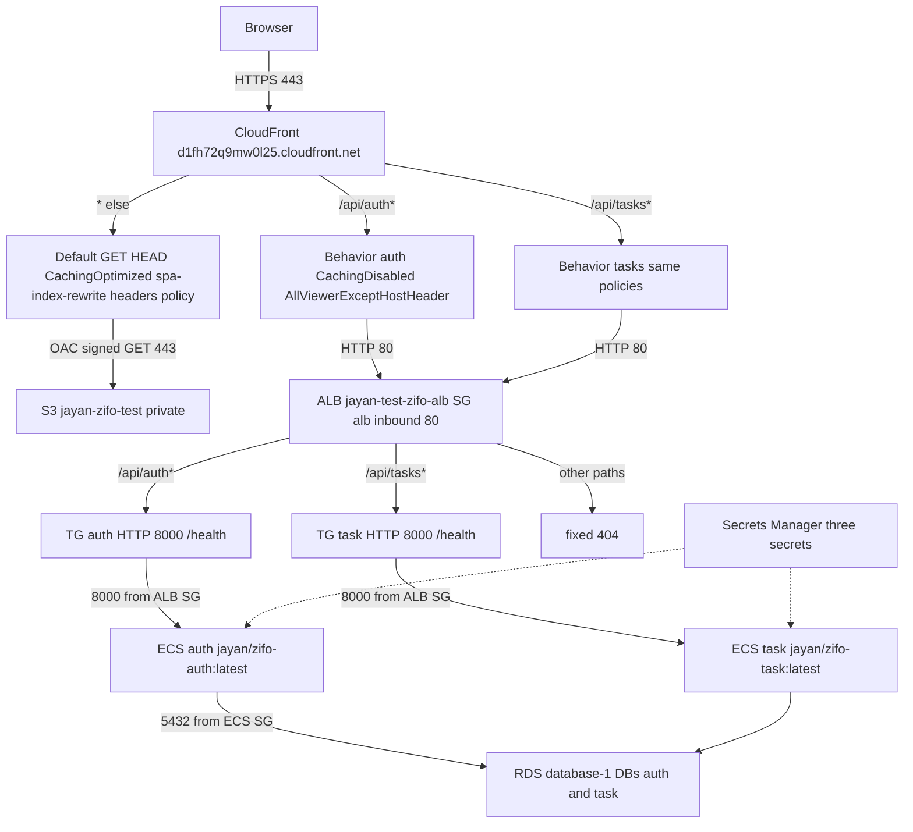
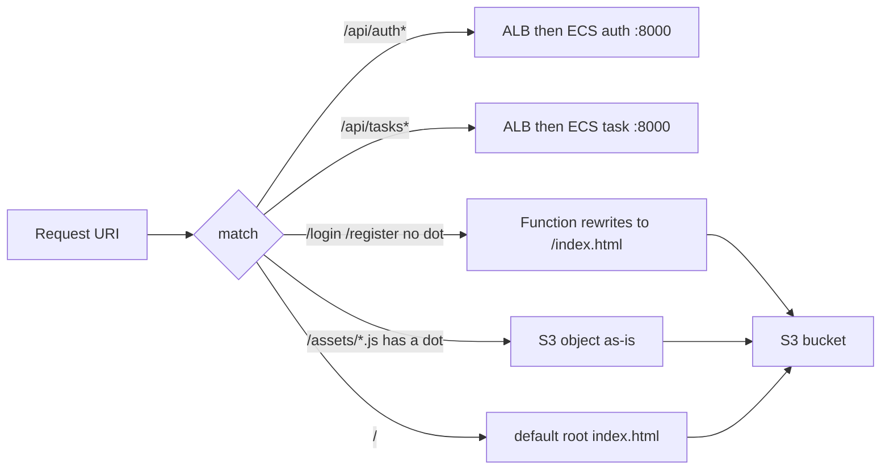
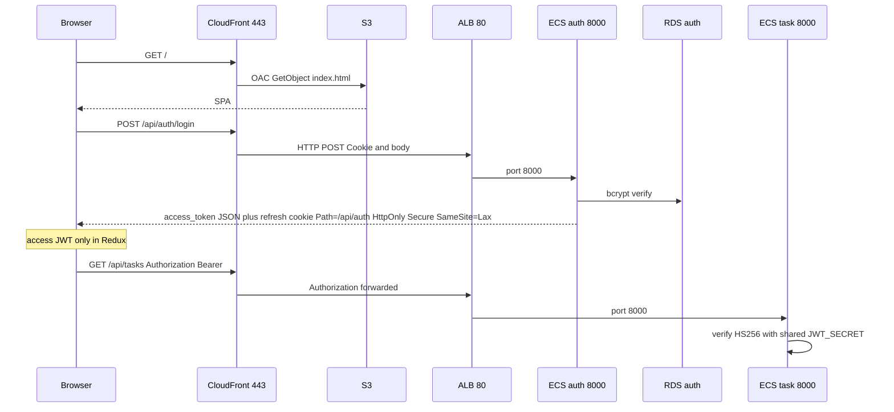
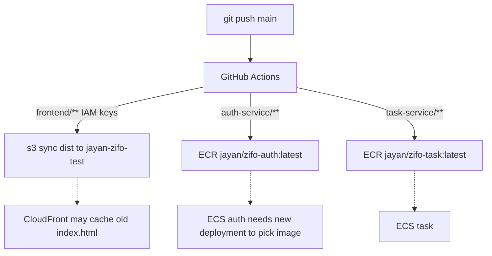

# Zifo task app — low-level design

AWS account `229691749767` · region `ap-southeast-2` · CloudFront `E4EDW133P7EXJ`

The browser talks to **one hostname**: `https://d1fh72q9mw0l25.cloudfront.net`. React uses relative `/api/auth` and `/api/tasks`. It never calls S3, ECS, or RDS. Locally nginx `:3000` (or Docker `:9000`) did the same job.

Open [lld.html](lld.html) in a browser → **Ctrl+P** → **Save as PDF** for a downloadable copy.

## Dummy story

1. Person opens the CloudFront URL (HTTPS 443). That is the shop front.
2. HTML/JS/CSS come from a locked S3 cupboard. Only CloudFront has the key (OAC + bucket policy).
3. Login and tasks go through an ALB: `/api/auth*` → auth, `/api/tasks*` → task.
4. Each service uses its own Postgres database on one RDS instance. Secrets are in Secrets Manager, not GitHub.

## Runtime

## Path split

Function `spa-index-rewrite` is on the **S3 behavior only**.

## Login and tokens

ECS sets `COOKIE_SECURE=true`. Local Compose uses `false`.

## Deploy

CI uses GitHub `AWS_*` secrets. It does not read Secrets Manager. ECS uses ARN suffix `:DATABASE_URL::` / `:JWT_SECRET::`.

## Ports

| Hop | Port | Allow |
| --- | --- | --- |
| Browser → CloudFront | 443 | Internet |
| CloudFront → S3 | 443 | Distribution E4EDW133P7EXJ via OAC + bucket policy |
| CloudFront → ALB | 80 | SG `jayan-test-zifo-alb` inbound 80 |
| ALB → ECS | 8000 | SG `jayan-test-zifo-ecs` inbound 8000 from ALB SG |
| ECS → RDS | 5432 | SG `jayan-test-zifo-rds` inbound 5432 from ECS SG |
| GitHub Actions → AWS APIs | 443 | IAM keys in GitHub |

## Named resources

| Piece | Name |
| --- | --- |
| CloudFront | https://d1fh72q9mw0l25.cloudfront.net |
| S3 | jayan-zifo-test |
| SPA function | spa-index-rewrite |
| Headers | zifo-spa-security-headers |
| ALB | jayan-test-zifo-alb-1511092230.ap-southeast-2.elb.amazonaws.com |
| TGs | jayan-test-zifo-auth-tg, jayan-test-zifo-task-tg |
| ECS | cluster jayan-test-zifo, services auth / task |
| ECR | jayan/zifo-auth, jayan/zifo-task |
| RDS | database-1, databases auth and task |
| Secrets | jayan-zifo/auth/database-url, jayan-zifo/task/database-url, jayan-zifo/jwt-secret |
| VPC | vpc-0bb18839614a614d0 |

Do not use the ALB DNS or S3 URL as the product site. Do not attach `spa-index-rewrite` to API behaviors.
