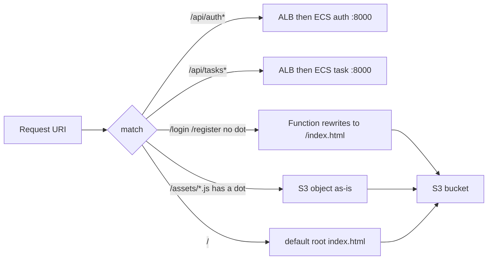
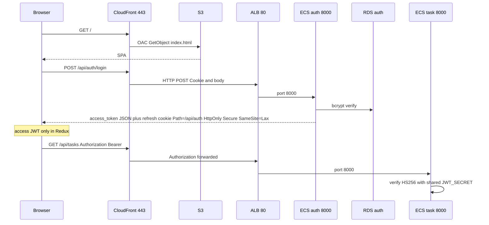
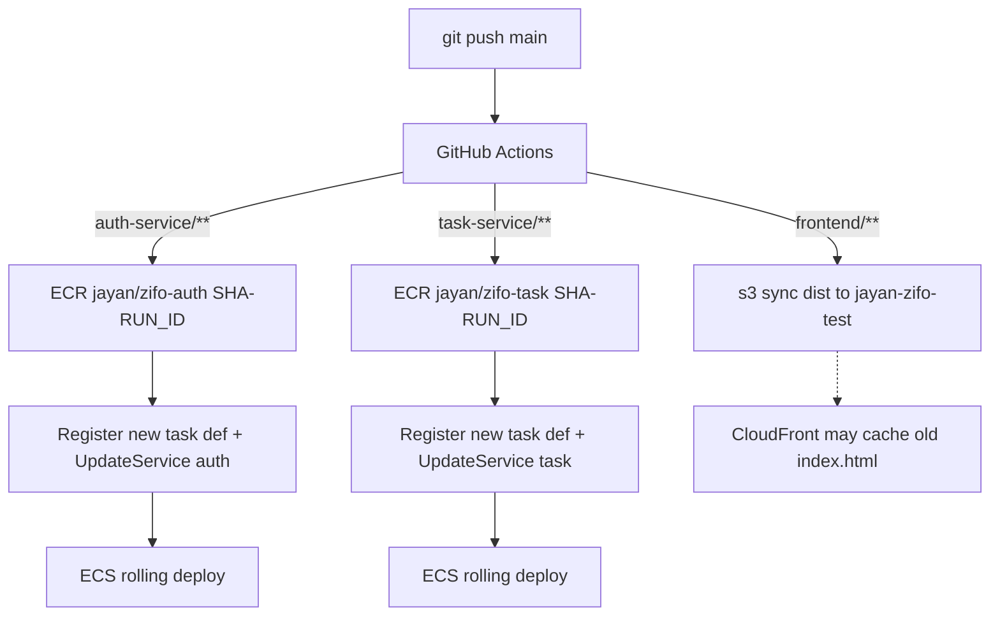

# Zifo task app — low-level design

AWS account `229691749767` · region `ap-southeast-2` · CloudFront `E4EDW133P7EXJ`

The browser talks to **one hostname**: `https://d1fh72q9mw0l25.cloudfront.net`. React uses relative `/api/auth` and `/api/tasks`. It never calls S3, ECS, or RDS. Locally nginx `:3000` (or Docker `:9000`) did the same job.

Open [lld.html](lld.html) in a browser → **Ctrl+P** → **Save as PDF** for a downloadable copy.

## Dummy story

1. Person opens the CloudFront URL (HTTPS 443). That is the shop front.
2. HTML/JS/CSS come from a locked S3 cupboard. Only CloudFront has the key (OAC + bucket policy).
3. Login and tasks go through an ALB: `/api/auth*` → auth, `/api/tasks*` → task.
4. Each service uses its own Postgres database on one RDS instance. Secrets are in Secrets Manager, not GitHub.

## Runtime

## Path split

Function `spa-index-rewrite` is on the **S3 behavior only**.

## Login and tokens

ECS sets `COOKIE_SECURE=true`. Local Compose uses `false`.

## Deploy

CI uses GitHub `AWS_*` secrets. It does not read Secrets Manager. ECS injects JSON keys with `:DATABASE_URL::` / `:JWT_SECRET::`. API workflows tag `${GITHUB_SHA}-${GITHUB_RUN_ID}` (immutable ECR), then `amazon-ecs-render-task-definition` + `amazon-ecs-deploy-task-definition` so a push **does** roll Fargate. Frontend deploy is S3 only; invalidate `/index.html` if the UI looks stale.

## Ports

| Hop | Port | Allow |
| --- | --- | --- |
| Browser → CloudFront | 443 | Internet |
| CloudFront → S3 | 443 | Distribution E4EDW133P7EXJ via OAC + bucket policy |
| CloudFront → ALB | 80 | SG `jayan-test-zifo-alb` inbound 80 |
| ALB → ECS | 8000 | SG `jayan-test-zifo-ecs` inbound 8000 from ALB SG |
| ECS → RDS | 5432 | SG `jayan-test-zifo-rds` inbound 5432 from ECS SG |
| GitHub Actions → AWS APIs | 443 | IAM keys in GitHub |

## Named resources

| Piece | Name |
| --- | --- |
| CloudFront | https://d1fh72q9mw0l25.cloudfront.net |
| S3 | jayan-zifo-test |
| SPA function | spa-index-rewrite |
| Headers | zifo-spa-security-headers |
| ALB | jayan-test-zifo-alb-1511092230.ap-southeast-2.elb.amazonaws.com |
| TGs | jayan-test-zifo-auth-tg, jayan-test-zifo-task-tg |
| ECS | cluster jayan-test-zifo, services auth / task, Fargate public IP on |
| ECR | jayan/zifo-auth, jayan/zifo-task (tag immutability on) |
| RDS | database-1 single-AZ, databases auth and task, backup retention 1 day |
| Secrets | jayan-zifo/auth/database-url, jayan-zifo/task/database-url, jayan-zifo/jwt-secret |
| VPC | vpc-0bb18839614a614d0 default; subnets ap-southeast-2a/2b/2c |

Do not use the ALB DNS or S3 URL as the product site. Do not attach `spa-index-rewrite` to API behaviors.

## Production readiness (as-built vs not built)

This section is evidence for reviewers. **As-built** is in AWS or git. **Not built** is out of scope or blocked (for example free-tier RDS).

### High availability

Three ALB/Fargate AZs do **not** make the whole application highly available. `database-1` is **Single-AZ**. If that AZ or instance fails, **both** auth and task APIs fail even if Fargate still has capacity in other AZs.

| Item | Status | Detail |
| --- | --- | --- |
| ALB AZs | As-built | Internet-facing ALB mapped to default subnets in **ap-southeast-2a, 2b, 2c** |
| Fargate subnets | As-built | Same three public subnets so a scaled-out task can land in another AZ |
| Task count | As-built | Desired **1** per service (`auth`, `task`) |
| Autoscale | As-built | Enabled; scales from **1** up to **4** |
| Rolling deploy | As-built | Min healthy **100%**, max **200%**, circuit breaker **on**, rollback **on**, health grace **120s** |
| RDS | As-built | **Single-AZ** `database-1`. Availability bottleneck for the demo |
| CloudFront / S3 | As-built | Multi-edge CDN; objects in regional bucket |

**RDS Multi-AZ vs read replica (not built):** login, refresh, and task CRUD **write** on the hot path. **Multi-AZ** (sync standby, same endpoint, automatic failover) is the correct production HA pattern for that writer. **Read replica** is the wrong tool here (async **reads** only; writes stay on the primary; promote + new URL; extra instance). This instance was created on the **free-tier / Dev** path, which **does not offer Multi-AZ**. A replica is also not free. No RDS Modify and no replica for this demo.

### Private networking (demo, not a private backend)

| Item | Status | Detail |
| --- | --- | --- |
| Fargate public IP | As-built **on** | So tasks pull ECR without NAT. ENIs are reachable from the internet on **no** port unless an SG allows it; app port **8000** is only from the ALB SG |
| ALB SG | As-built | Inbound **80 from 0.0.0.0/0**. CloudFront is not restricted to the CloudFront prefix list |
| Origin protocol | As-built | CloudFront → ALB **HTTP 80** (TLS ends at CloudFront) |
| RDS | As-built | 5432 only from ECS SG; not 0.0.0.0/0 |
| Fully private backend | **Not built** | Would need private subnets, no public IP, NAT or VPC endpoints for ECR/logs/secrets, ALB 80/443 only from CloudFront prefix list, HTTPS to ALB |

### Automatic backend deployments

| Item | Status | Detail |
| --- | --- | --- |
| Frontend | As-built | `frontend.yml`: `npm ci` / build / `aws s3 sync dist --delete` |
| APIs | As-built in git | `auth-service.yml` / `task-service.yml`: build, push immutable tag, **register new task definition**, **update service**, wait for stability |
| IAM | As-built | User `github-zifo-s3`: S3 + ECR push + `ecs:DescribeTaskDefinition` `RegisterTaskDefinition` `UpdateService` `DescribeServices` + `iam:PassRole` on `ecsTaskExecutionRole` |
| Tag `latest` | Not used for rollouts | Immutable tags; each run is `${GITHUB_SHA}-${GITHUB_RUN_ID}` |

### Autoscaling, retries, circuit breakers, backups

| Control | Where | Status |
| --- | --- | --- |
| ALB health | `GET /health` on target port 8000, success 200 | As-built |
| Unhealthy target | ALB stops sending traffic; ECS service starts a replacement | As-built |
| ECS circuit breaker + rollback | Service deployment | As-built at create |
| RDS connect retry | `init_db` in `app/main.py`: 30 × 1s on `OperationalError` then fail | As-built in code |
| HTTP client retries | Browser refresh-once on 401 | As-built in frontend; not a mesh/sidecar |
| Service auto scaling | Enabled, desired **1**, max **4** | As-built |
| RDS automated backup | Retention **1 day**, no cross-region replica | As-built |
| Restore drill | Restore snapshot to a new instance and run login | **Not done** — this document is not a restore test record |
| RDS Multi-AZ | Correct prod HA for this writer; **not offered on free-tier RDS** | **Not built** |
| RDS read replica | Wrong pattern (reads only) and not free | **Not built** |

### Security (controls vs audit)

**Implemented (not a pentest report):**

- S3 Block Public Access; OAC + bucket policy locked to distribution `E4EDW133P7EXJ`; ACLs disabled
- CloudFront HTTPS redirect; SPA CSP / nosniff / DENY / no-referrer / Permissions-Policy / HSTS on the S3 behavior
- Access JWT in Redux only; refresh `HttpOnly` `SameSite=Lax` `Path=/api/auth`; `COOKIE_SECURE=true` on ECS
- Passwords bcrypt; SQLAlchemy parameters; task `sub` from JWT; other users’ tasks 404
- Secrets Manager for `DATABASE_URL` and `JWT_SECRET`; execution role `GetSecretValue`; JSON key `:KEY::` on the ARN
- SG allow-lists: ALB 80 world (demo), ECS 8000 from ALB, RDS 5432 from ECS
- API cache disabled; `Authorization` and `Cookie` forwarded on API behaviors

**Not in this document:** vulnerability scan output, IAM Access Analyzer findings triage, WAF, CloudFront–ALB TLS, prefix-list restriction, restore test, or a signed security review. Those were not executed as an audit for this project.

### How to confirm in the console

1. ECS services: running count **1**, autoscale max **4**, circuit breaker.
2. Task networking: public IP, subnet IDs (2a/2b/2c).
3. RDS: Multi-AZ **No** (free tier); backup window / retention.
4. ECR: latest image tag is `sha-runid`; task def revision image URI matches.
5. CloudWatch log groups `/ecs/jayan-zifo-auth` and `/ecs/jayan-zifo-task`.
